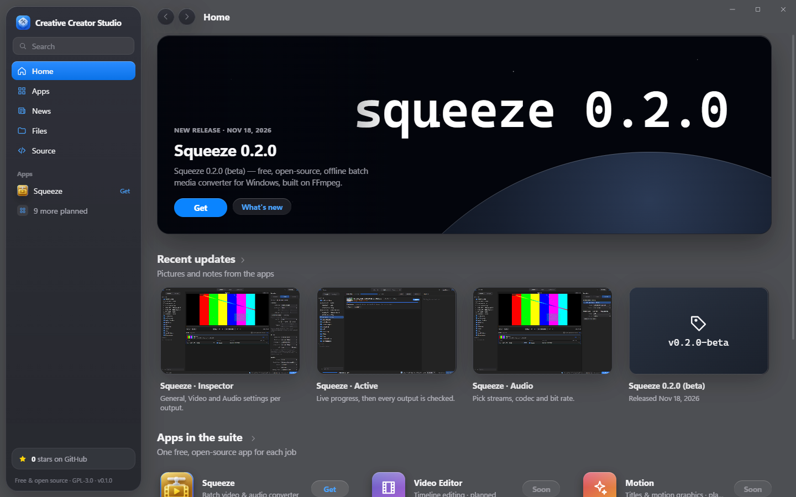
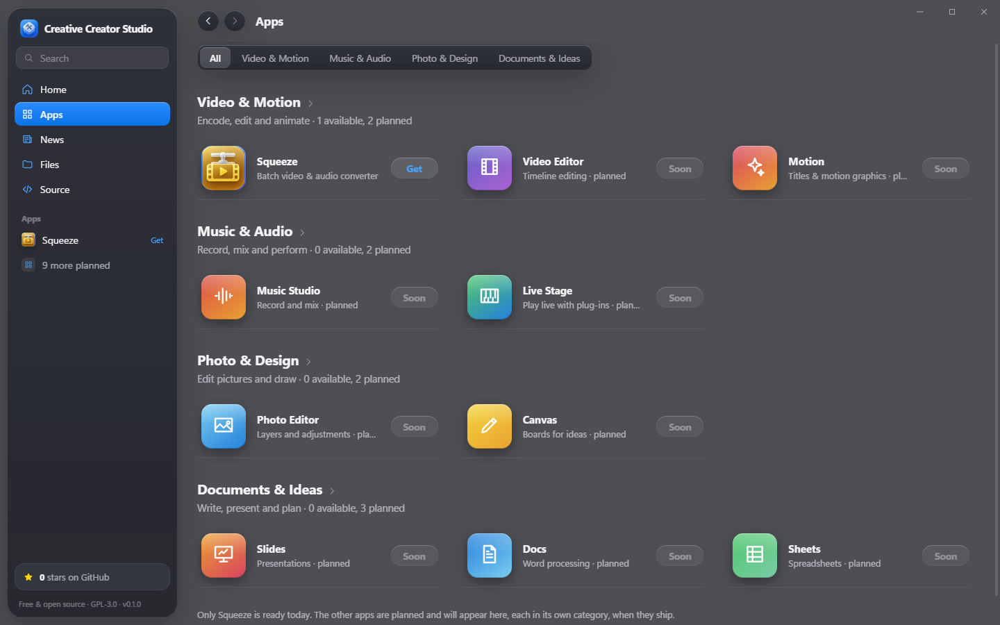
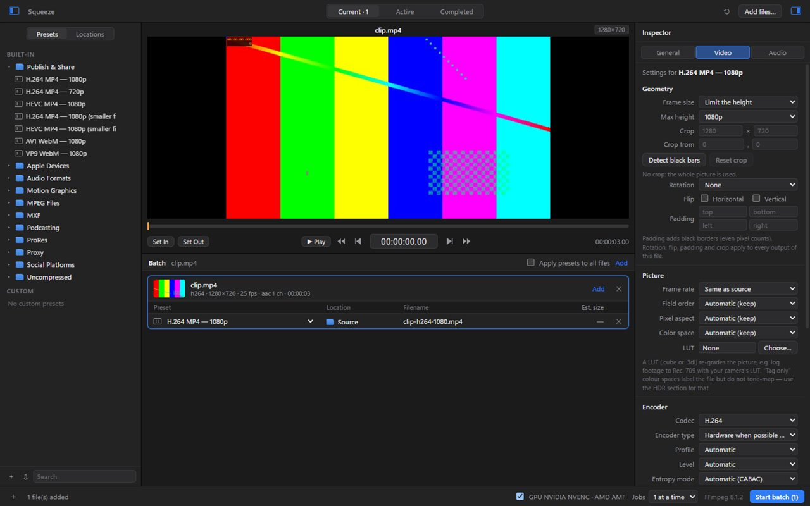
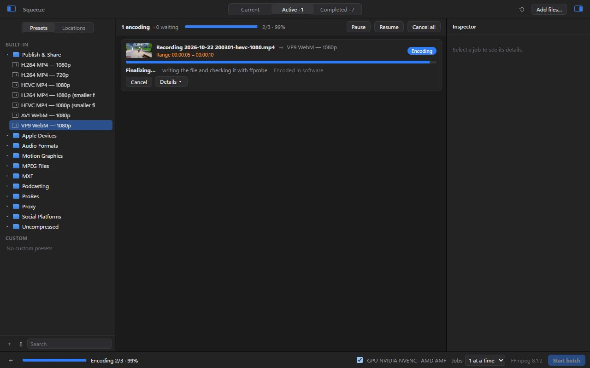
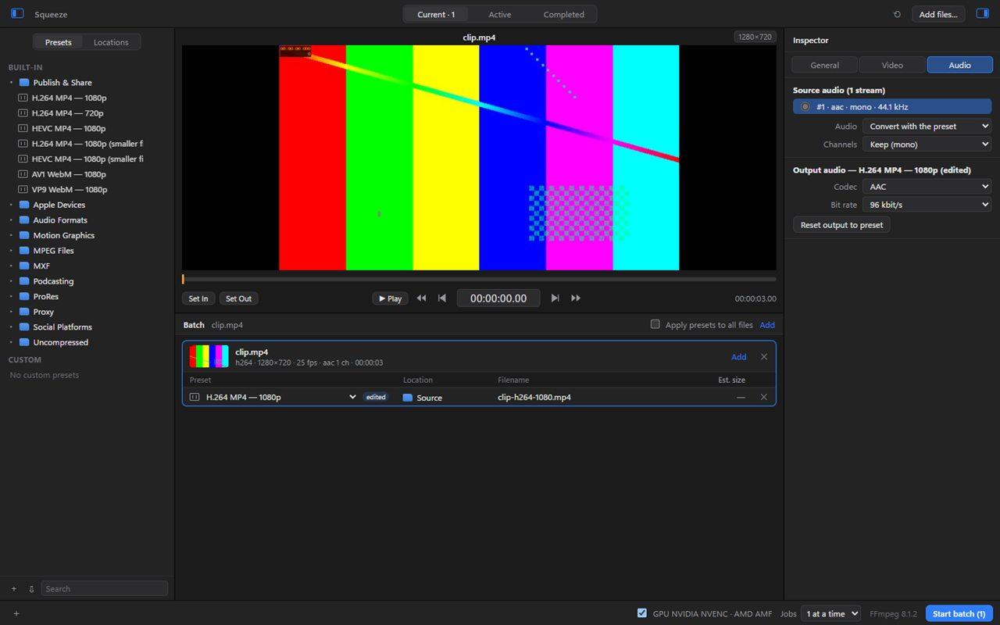
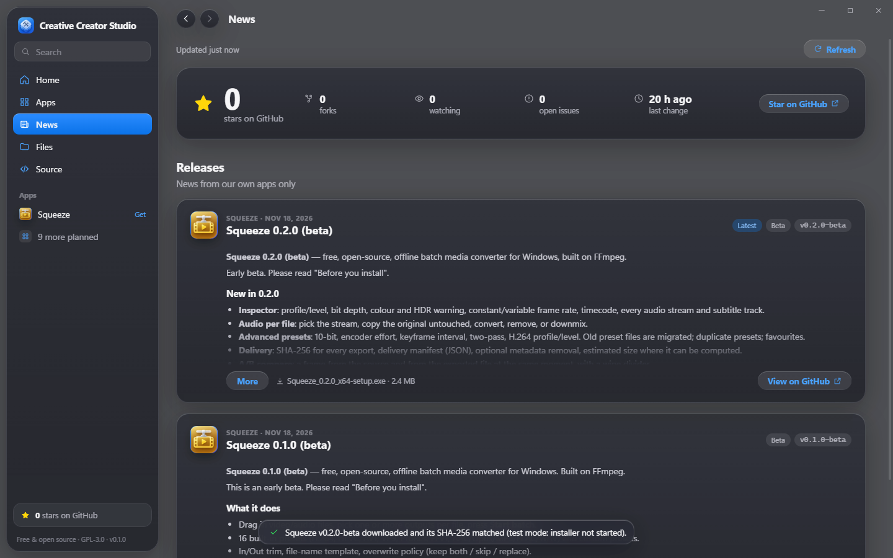
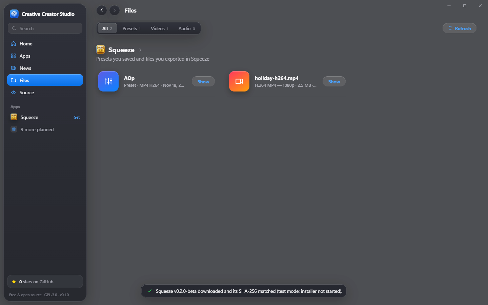
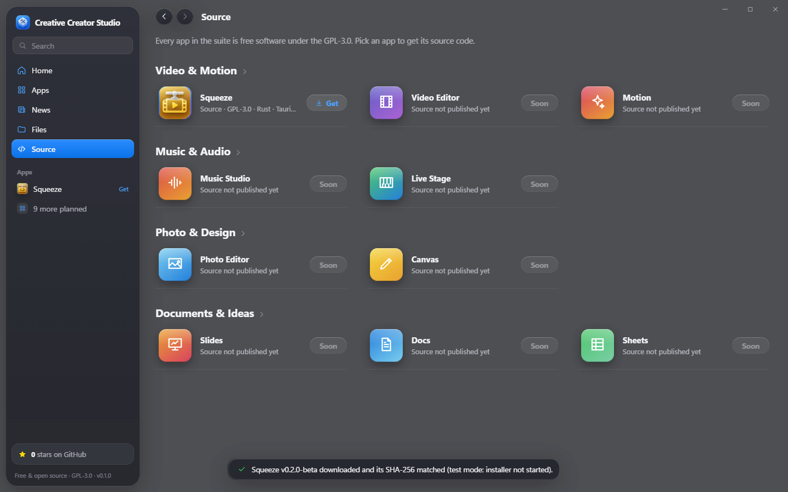

# Creative Creator Studio

A small Windows app to **install, open and follow the suite's free, open-source apps**. It looks like the Apple Developer app: translucent "liquid glass" panels over the window's acrylic blur, with a Home page of recent pictures, an Apps page sorted by purpose, News, Files and Source.



## The apps

Only **Squeeze** exists today. The others are planned, and the launcher says so ("Soon") instead of pretending.

| App | What it is for | Status |
|---|---|---|
|  **Squeeze** | Batch video and audio converter, offline, checks every output | **Available** — install it from the launcher |
| Video Editor | Timeline video editing | Planned |
| Motion | Titles and motion graphics | Planned |
| Music Studio | Multitrack recording and mixing | Planned |
| Live Stage | Playing live with plug-ins | Planned |
| Photo Editor | Layers and adjustments | Planned |
| Canvas | An open whiteboard for ideas | Planned |
| Slides | Presentations | Planned |
| Docs | Word processing | Planned |
| Sheets | Spreadsheets and charts | Planned |

They are grouped by purpose: **Video & Motion**, **Music & Audio**, **Photo & Design**, **Documents & Ideas**.



### Squeeze

Convert many video and audio files at once with ready-made presets for the web, phones, editing and archiving. It works offline, checks every output and never uploads your media. Source and releases: <https://github.com/plawanpawin-byte/squzze>

| Inspector | Active | Audio |
|---|---|---|
|  |  |  |

## Pages

| Page | What it shows |
|---|---|
| Home | Banner for the latest release, recent pictures from the apps, the app list, live GitHub numbers |
| Apps | Every app, grouped by purpose |
| News | GitHub stars, forks, watchers, issues and every release note for our own apps (cached for offline use) |
| Files | Things you saved in installed apps, per app: Squeeze custom presets (for example one named "AOp") and finished exports |
| Source | Per-app source code: download a `.zip` of `main` or any release into Downloads, or copy the `git clone` command |





## Install an app

**Get** downloads `Squeeze_*_x64-setup.exe` from the latest GitHub release, checks it against that release's `SHA256.txt`, and only then runs it silently (per-user install, no admin rights). If the hash does not match, the file is deleted and nothing runs.

The launcher only reads public GitHub data and only opens links under `github.com/plawanpawin-byte/squzze`. It can reveal or open only files it listed itself.

## Build

```bash
npm install
npx tauri build
```

The Rust crate is its own Cargo workspace, so it builds apart from the app crates. You need Node 20+, Rust stable and the WebView2 runtime (already on Windows 11).

## Test

```bash
node scripts/e2e.mjs <path-to>/creator-suite-launcher.exe <screenshot-dir>
```

The end-to-end test drives the real app over WebView2 and uses fake Squeeze data (`CS_LAUNCHER_SQUEEZE_DATA`). It downloads and hash-checks the installer without running it (`CS_LAUNCHER_DRY_INSTALL`), ignores any Squeeze already on the PC (`CS_LAUNCHER_FORCE_NOT_INSTALLED`) and deletes the source zip it saves to Downloads. `scripts/real-install.mjs` does a real install through the launcher.

## Licence

GPL-3.0-or-later. See [LICENSE](LICENSE).
